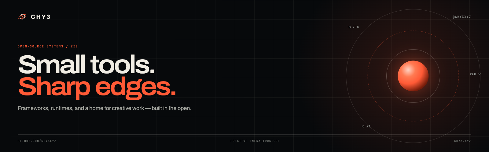
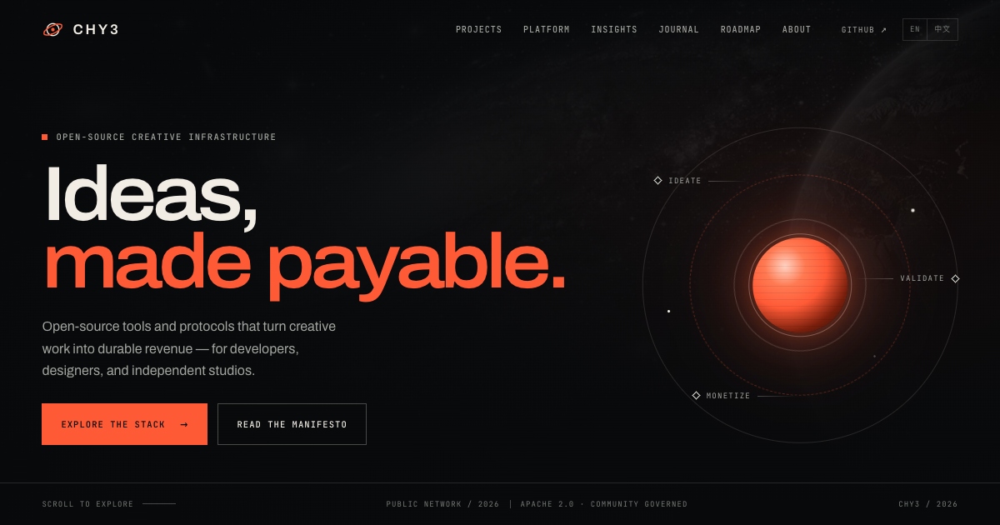

<h3>Open-source systems in Zig. Creative infrastructure on the web.</h3>

I build small, sharp tools that keep the stack honest — frameworks, runtimes, ORMs, and a site for creative work that pays for itself.

[**chy3.xyz**](https://chy3.xyz) &nbsp;·&nbsp; [**repositories**](https://github.com/chy3xyz?tab=repositories) &nbsp;·&nbsp; [**say hello**](https://github.com/chy3xyz/chy3xyz/issues)

---

### Now

- Building **[zmodu](https://github.com/chy3xyz/zmodu)** — a compile-time modular framework and worker-oriented runtime for Zig.
- Shipping **[zfinal](https://github.com/chy3xyz/zfinal)** — an AI-first Zig web framework with codegen, manifests, and an ORM.
- Maintaining **[zdoc](https://github.com/chy3xyz/zdoc)** — turn a folder of Markdown into a documentation site.
- Running **[chy3.xyz](https://chy3.xyz)** — a bilingual home for open-source creative infrastructure.

### Selected work

| Project | Stack | What it is |
|:--|:--|:--|
| **[zmodu](https://github.com/chy3xyz/zmodu)** | `Zig` | Compile-time modular application framework and worker-oriented runtime. [Docs](https://chy3xyz.github.io/zmodu/) |
| **[zfinal](https://github.com/chy3xyz/zfinal)** | `Zig` | AI-first web framework: codegen, JSON manifests, ORM, CSRF, and WebSocket. |
| **[zent](https://github.com/chy3xyz/zent)** | `Zig` | Comptime-driven entity framework / ORM for SQLite, PostgreSQL, and MySQL. |
| **[zdoc](https://github.com/chy3xyz/zdoc)** | `Zig` | Markdown folder → docs site. One binary, no config. Fork of Zine. |
| **[chy3.xyz](https://github.com/chy3xyz/chy3xyz)** | `HTML` `CSS` | This repository. Bilingual site for CHY3, built with zdoc. |

Also pinned: **[vai](https://github.com/chy3xyz/vai)** · **[vf](https://github.com/chy3xyz/vf)** · **[zgraphql](https://github.com/chy3xyz/zgraphql)** · **[rszero](https://github.com/chy3xyz/rszero)**

### Toolbox

  
  
  
  
  
  
  
  

### The site

[**chy3.xyz**](https://chy3.xyz) is the public face of CHY3: a bilingual, content-driven site about making creative work pay. It is built with [zdoc](https://github.com/chy3xyz/zdoc), hand-written CSS, and a very small amount of vanilla JavaScript — no framework, no bundler. The source lives in this repository; build and deploy notes are in **[DEVELOPMENT.md](DEVELOPMENT.md)**.

### Writing

Notes from the site on making creative work pay:

- [The 2026 Creator Economy: From Attention to Value](https://chy3.xyz/insights/creator-economy-2026/)
- [Designing Commercial Paths for Open-Source Projects](https://chy3.xyz/insights/open-source-monetization/)
- [Technical Architecture for Creative Monetization](https://chy3.xyz/insights/platform-ecosystem-design/)

### Say hello

If you're building Zig infrastructure, or trying to make creative work pay, [open an issue](https://github.com/chy3xyz/chy3xyz/issues) or find me on **[GitHub](https://github.com/chy3xyz)**.

<b>中文简介</b>

 

我是 **chy3xyz**，主要用 Zig 构建开源基础设施：应用框架、运行时、ORM、文档工具，以及 [chy3.xyz](https://chy3.xyz)。

- 当前：[zmodu](https://github.com/chy3xyz/zmodu)、[zfinal](https://github.com/chy3xyz/zfinal)、[zdoc](https://github.com/chy3xyz/zdoc)
- 代表项目：[zent](https://github.com/chy3xyz/zent)、[vai](https://github.com/chy3xyz/vai)、[vf](https://github.com/chy3xyz/vf)
- 写作：[Insights](https://chy3.xyz/insights/) — 关于开源商业化与创意经济
- 联系：[GitHub](https://github.com/chy3xyz) 或 [提交 issue](https://github.com/chy3xyz/chy3xyz/issues)

  Small tools. Sharp edges. Open source, all the way down.

